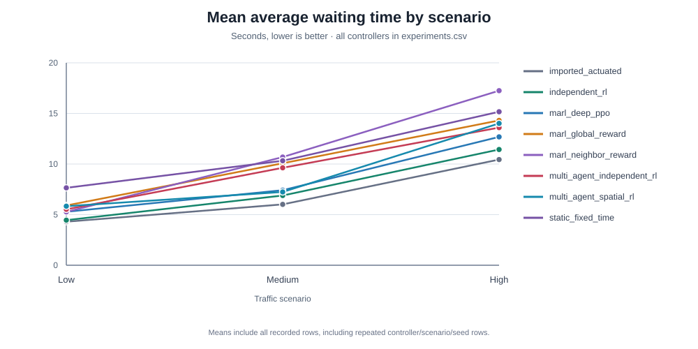

# Adaptive Traffic Lights in Skopje with Multi-Agent RL

Compares traffic-light controllers on a real Skopje road network in SUMO:
fixed-time baselines, independent Q-learning, and coordinated multi-agent RL.

Eight traffic lights on one corridor are learning agents:
`A9, A18, A19, A20, A24, A25, A26, A29`. Every other light in the network
keeps its original SUMO program.

> The road network comes from OpenStreetMap. Traffic demand is synthetic, not
> measured Skopje data, and the signal timings are not the city's official ones.

## Controllers

| Label in results | What it is |
| --- | --- |
| `static_fixed_time` | Fixed green durations, original phase order |
| `imported_actuated` | The actuated programs from the imported SUMO network |
| `independent_rl` | Q-learning on one agent, others on SUMO programs |
| `multi_agent_independent_rl` | All 8 agents learn, each with its own local reward |
| `multi_agent_spatial_rl` | Same, plus each agent sees its neighbors' congestion |
| `marl_neighbor_reward` | Reward = 70% own + 30% neighbors' average |
| `marl_global_reward` | Every agent gets the corridor-wide average reward |
| `marl_deep_ppo` | One shared PPO network for all 8 agents, local reward |
| `marl_attention_ppo` | Same, plus self-attention across junctions (no results yet) |

## Setup (Windows)

1. Install [SUMO](https://sumo.dlr.de/docs/Downloads.php), set `SUMO_HOME`, and add its `bin` folder to `PATH`.
2. Install dependencies and check the setup:

```powershell
.\.venv\Scripts\Activate.ps1
pip install -r requirements.txt -r requirements-dev.txt
python scripts/setup/check_setup.py
```

## Quick start

```powershell
# Generate low / medium / high demand scenarios
python scripts/demand/generate_traffic_demand.py --all --seed 42

# Watch the corridor with its original signal programs
python scripts/experiments/run_traffic_scenario.py --scenario medium --seed 42 --gui
```

## Running experiments

Every run that evaluates a controller appends one row to `results/experiments.csv`.

**Baselines**

```powershell
python scripts/experiments/run_static_fixed_time_suite.py --seeds 42
python scripts/experiments/run_imported_actuated_suite.py --seed 42
```

**Single-agent Q-learning**

```powershell
python scripts/experiments/run_q_learning.py train    --agent-id A19 --scenario medium --seed 42 --episodes 50 --checkpoint checkpoints/a19_medium.json
python scripts/experiments/run_q_learning.py evaluate --agent-id A19 --scenario medium --seed 42 --checkpoint checkpoints/a19_medium.json
```

**Multi-agent Q-learning**

```powershell
python scripts/experiments/run_multi_agent_q_learning.py train    --scenario medium --seed 42 --episodes 50 --checkpoint checkpoints/marl_medium.json
python scripts/experiments/run_multi_agent_q_learning.py evaluate --scenario medium --seed 42 --checkpoint checkpoints/marl_medium.json
```

### Watch a trained controller

Replay a saved controller in the SUMO traffic GUI without starting another training run:

```powershell
python scripts/sumo_visualization/watch_trained_controller.py --controller single-agent --scenario medium --agent-id A19
python scripts/sumo_visualization/watch_trained_controller.py --controller multi-agent --scenario medium --reward-mode local
python scripts/sumo_visualization/watch_trained_controller.py --controller deep-marl --scenario medium
```

The script loads the matching checkpoint from `checkpoints/` by default and does not append a row to `results/experiments.csv`.

Pass `--checkpoint` to replay another saved model, or `--help` to change the scenario, seed, agents, or playback duration.

Useful flags for both runners:

| Flag | Effect |
| --- | --- |
| `--resume` | Continue an interrupted training run |
| `--allow-cross-seed` | Evaluate on a different traffic seed than training |
| `--reward-mode local\|neighbor_aware\|global` | Reward coordination (multi-agent only) |
| `--spatial-observations` | Agents see neighbor congestion flags (multi-agent only) |
| `--agents A19 A20` | Train only a subset of the corridor (multi-agent only) |

`neighbor_aware` averages over all of an agent's audited neighbors that are in the run
(up to six for A26). `--neighbor-limit` only applies to `--spatial-observations`.

Use the same `--reward-mode` / `--spatial-observations` for train and evaluate.
Checkpoints refuse to load if the scenario, seed, agents, or settings don't match.

## Looking at results

```powershell
python scripts/analysis/summarize_experiments.py                       # table by controller, scenario, episode length
python scripts/analysis/visualize_results.py                           # plots in results/plots/
python scripts/analysis/generate_waiting_time_chart.py                  # refresh the README SVG from experiments.csv
python scripts/analysis/experiment_matrix.py results/experiments.csv   # which runs are still missing
python scripts/analysis/training_curve.py logs/<run>.log --csv out.csv # reward curve from a training log
python scripts/analysis/merge_results.py other_machine.csv             # merge results from another machine
```

Only compare runs with the same episode length. Baselines use 3600 seconds.

### Current comparison

Mean average waiting time in seconds across full 3600-second-demand evaluations for every controller label in the results CSV.
Lower is better.
The results use synthetic demand and a limited set of seeds; the comparison is descriptive, not evidence of statistical significance.



| Controller | Low | Medium | High |
| --- | ---: | ---: | ---: |
| `static_fixed_time` | 7.65 | 10.33 | 15.17 |
| `imported_actuated` | 4.31 | 6.01 | 10.44 |
| `independent_rl` | 4.46 | 6.89 | 11.44 |
| `multi_agent_independent_rl` | 5.53 | 7.68 | 13.60 |
| `multi_agent_spatial_rl` | 5.84 | 7.24 | 14.01 |
| `marl_neighbor_reward` | 5.27 | 8.00 | 17.25 |
| `marl_global_reward` | 5.91 | 7.57 | 14.31 |
| `marl_deep_ppo` | 5.28 | 7.42 | 12.68 |

Values are calculated from `results/experiments.csv` using only rows with 3600 seconds of demand, grouped by controller and scenario. Short trials are excluded.
Run `python scripts/analysis/generate_waiting_time_chart.py` to refresh the chart after adding experiment rows.
If a controller/scenario has repeated full-length rows for a seed, the chart averages those rows rather than silently choosing one result.
Use `python scripts/analysis/summarize_experiments.py` to inspect run counts and standard deviations.
The imported actuated baseline has the lowest mean wait in all three scenarios in the current results table.
The learned controllers do not consistently improve on that baseline, and their relative performance changes with demand level.
These results do not establish a novel or generally superior controller.

## Deep RL wrappers

`src/environment/gym_wrapper.py` exposes the environment as:

- `CorridorParallelEnv`: PettingZoo parallel API, all agents
- `SingleAgentTrafficEnv`: Gymnasium API, one agent

```python
from src.environment import CorridorParallelEnv
from src.environment.multi_agent_environment import MultiAgentEnvironmentConfig

config = MultiAgentEnvironmentConfig(agent_ids=("A19", "A26"), demand_seconds=600.0)
with CorridorParallelEnv(config) as env:
    observations, infos = env.reset()
    actions = {agent: env.action_space(agent).sample() for agent in env.agents}
    observations, rewards, terminations, truncations, infos = env.step(actions)
```

Actions are `0 = KEEP`, `1 = NEXT_GREEN`. A safety layer enforces minimum/maximum
green and yellow transitions. A short PPO demo (`stable-baselines3` and `torch` are in `requirements-dev.txt`):

```powershell
python scripts/experiments/run_deep_rl_demo.py --algorithm ppo --scenario medium --timesteps 128 --episode-seconds 600
```

## Deep MARL (shared-parameter PPO)

`src/training/deep_marl.py` trains one PyTorch PPO network shared by all eight agents
(independent PPO: actor and critic see only the agent's own observation). Observations are
zero-padded to the widest junction and tagged with a one-hot agent ID.

- **Why shared:** SUMO is the bottleneck, and sharing gives the network 8x the samples per episode.
- **Why `local` reward:** no coordinated tabular reward won consistently, so this is the direct
  deep counterpart of `multi_agent_independent_rl`. Same budget: 300 episodes on seed 42.
- Rewards are scaled by a running return std and clipped to ±10 (like SB3's `VecNormalize`).

```powershell
python scripts/experiments/run_deep_marl.py train    --scenario medium --seed 42 *>&1 | Tee-Object logs/deep_marl_local_medium_seed42.log
python scripts/experiments/run_deep_marl.py evaluate --scenario medium --seed 42
python scripts/experiments/run_deep_marl.py evaluate --scenario medium --seed 43 --allow-cross-seed --checkpoint checkpoints/deep_marl_local_medium_seed42.pt
```

Other reward modes are recorded as `marl_deep_ppo_neighbor` / `marl_deep_ppo_global`.
Checkpoints are saved as `checkpoints/deep_marl_<reward>_<scenario>_seed<seed>.pt`.

**Results** (mean over seeds 42/43/44):

| Scenario | Controller | Avg wait (s) | Avg queue | Vehicles left | Teleports |
|---|---|---|---|---|---|
| low | `marl_deep_ppo` | 5.28 | 1.97 | 0.67 | 0.00 |
| low | `multi_agent_independent_rl` | 5.53 | 2.31 | 0.33 | 0.00 |
| medium | `marl_deep_ppo` | 7.42 | 5.77 | 1.00 | 0.00 |
| medium | `multi_agent_independent_rl` | 7.68 | 6.98 | 1.67 | 0.00 |
| high | `marl_deep_ppo` | 12.68 | 13.02 | 15.00 | 0.33 |
| high | `multi_agent_independent_rl` | 13.60 | 21.11 | 36.33 | 7.33 |

Across the three recorded seeds, deep PPO has lower mean waiting time than the tabular multi-agent controller in all three scenarios. In low and medium demand the gap is comparable to the seed-to-seed spread.
The imported actuated and single-agent RL baselines have lower mean waiting time than deep PPO in every scenario.

Caveats: high seed 43 leaves 41 vehicles in the network (vs 3 and 1 on seeds 42/44).
Medium training reward peaked around episodes 200–225 and dropped about 8% by the end; the final
checkpoint is the one evaluated, as for every tabular run.

## Self-attention PPO

`src/training/deep_marl_attention.py` is a separate controller that adds one self-attention layer to the shared PPO network, so
each junction can use the state of the other seven. Everything else matches `marl_deep_ppo`:
observations, local reward, PPO settings, gradient steps per episode and the 300-episode budget.

Attention needs all 8 observations at execution time and also makes the critic centralized, so the
comparison measures shared information as a whole, and the controller is not decentralized.

```powershell
python scripts/experiments/run_attention_ppo.py train    --scenario medium --seed 42 *>&1 | Tee-Object logs/deep_marl_attention_local_medium_seed42.log
python scripts/experiments/run_attention_ppo.py evaluate --scenario medium --seed 42
python scripts/experiments/run_attention_ppo.py evaluate --scenario medium --seed 43 --allow-cross-seed --checkpoint checkpoints/deep_marl_attention_local_medium_seed42.pt
```

Checkpoints are saved as `checkpoints/deep_marl_attention_<reward>_<scenario>_seed<seed>.pt`.

### Training settings

Both PPO trainers default to the settings that won the November 2026 tuning on real_signals (medium and
high, seeds 42-44, 150-episode runs):

| Flag | Default | Why |
| --- | --- | --- |
| `--approach-range` | 150 m | most stop-line lanes are ~18 m (three cars), so longer queues were invisible; each lane now counts vehicles up to 150 m upstream, stopping at the next agent |
| `--min-green` | 7 s | was 10 s; the actuated programs use the same 7 s, so both controllers work within identical limits |
| `--lr-decay` / `--no-lr-decay` | on | linear decay to zero over `--episodes`; keep `--episodes` unchanged when resuming |
| `--update-epochs` | 10 | was 4; learns faster per simulated episode |

Tried and kept off by default: `--reward-mode pressure` (exits counted 150 m downstream; tied with the local
reward on high, behind on medium), `--switch-penalty`, `--waiting-weight` above 0.1, `--entropy-coefficient`
above 0.01, `--decision-interval 2` and `--reward-mode neighbor_aware`. Checkpoints written before these flags
existed load with their old values (no approach range, 10 s minimum green, no decay), so pass those flags to
resume or evaluate them.

Limit PyTorch to one thread before training. On medium demand, 2 episodes with updates took 55 s instead of 162 s at the default 14 threads, with identical logged rewards and losses. Plain PPO and parallel runs have not been timed with this setting.

```powershell
$env:OMP_NUM_THREADS=1; $env:MKL_NUM_THREADS=1
```

### Faster runs with libsumo

`SKOPJE_LIBSUMO=1` runs SUMO inside the Python process through libsumo instead of over a TraCI socket. Results are identical: the `high` deep MARL evaluation row and two attention-PPO training episodes on medium matched TraCI value for value. It took 21 s instead of 55 s for those two episodes and 26 s instead of 63 s for the evaluation. libsumo has no GUI, so `--gui` refuses it.

```powershell
$env:SKOPJE_LIBSUMO=1; $env:OMP_NUM_THREADS=1; $env:MKL_NUM_THREADS=1
```

It applies to everything built on `MultiAgentTrafficEnvironment` (deep MARL, attention PPO, the imported actuated baseline); the static fixed-time runner keeps TraCI. The SUMO Python packages are pinned to the installed SUMO version (1.27.1) in `requirements.txt`. On Windows libsumo bundles a newer `sqlite3.dll` than Python, so `src/__init__.py` imports it first when the switch is on.

## Tests

```powershell
python -m pytest
```

## Project layout

```
src/
  agents/        Q-learning agent and state encoder
  baselines/     fixed-time and actuated controllers
  demand/        synthetic traffic generation
  environment/   SUMO environment, signals, rewards, Gym/PettingZoo wrappers
  evaluation/    metrics collection and results CSV
  training/      tabular and deep MARL training loops
scripts/
  analysis/      result summaries and charts
  demand/        synthetic demand generation and validation
  experiments/   SUMO runs and controller training/evaluation
  environment_inspection/ Gym wrapper and traffic-agent inspection
  network_inspection/     traffic-light audits and corridor reviews
  setup/                  local Python and SUMO checks
  sumo_visualization/     replay trained controllers in SUMO GUI
sumo/skopje/     network, demand, configs, and documentation
results/         experiments.csv, plots, training curves
checkpoints/     saved Q-tables and PPO networks
```

## More detail

See [scripts.md](scripts.md) for descriptions and example commands for every runnable script.

In Windows PowerShell, run `.\helpme.bat` from the repository root to list the available script commands.

On Linux or macOS, run `./helpme` from the repository root.

Add `--full` to either command to open the detailed usage manual.

Design notes live in `sumo/skopje/documentation/`:

- `selected_corridor.md`: why these 8 lights, neighbor distances
- `traffic_demand.md`: how scenarios are generated
- `traffic_agent_interface.md`: observations, actions, rewards, safety rules
- `static_fixed_time_baseline.md`, `imported_actuated_baseline.md`: baselines
- `spatial_observation_sharing.md`: neighbor-observation design and results

## Status

Done: baselines, single/multi-agent Q-learning, coordinated MARL (spatial,
neighbor-aware, global), deep MARL (shared PPO), metrics and plots, Gym/PettingZoo wrappers.

Not done: calibrated real-world demand,
junction geometry cleanup in netedit.

## Real-signals network

The Candidate 1 signals can be recoded to real Skopje behaviour in a separate network variant. Set `SKOPJE_NETWORK=real_signals` to use it; its results, checkpoints and audit are kept apart from the original ones. See [`sumo/skopje/documentation/real_signals_network.md`](sumo/skopje/documentation/real_signals_network.md).
