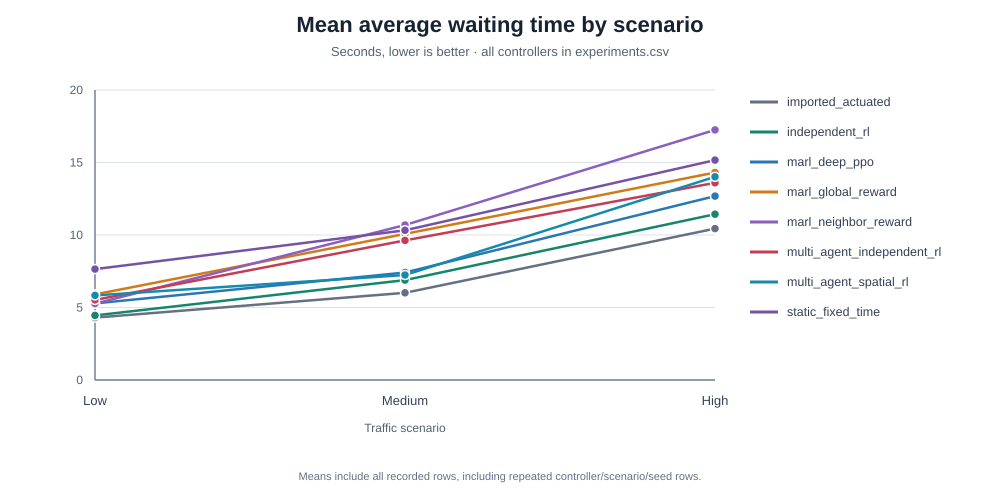

# Adaptive Traffic Lights in Skopje with Multi-Agent RL

Compares traffic-light controllers on a real Skopje road network in SUMO:
fixed-time baselines, independent Q-learning, and coordinated multi-agent RL.

Eight traffic lights on one corridor are learning agents:
`A9, A18, A19, A20, A24, A25, A26, A29`. Every other light in the network
keeps its original SUMO program.

> The road network comes from OpenStreetMap. Traffic demand is synthetic, not
> measured Skopje data, and the signal timings are not the city's official ones.

## Controllers

| Label in results | What it is |
| --- | --- |
| `static_fixed_time` | Fixed green durations, original phase order |
| `imported_actuated` | The actuated programs from the imported SUMO network |
| `independent_rl` | Q-learning on one agent, others on SUMO programs |
| `multi_agent_independent_rl` | All 8 agents learn, each with its own local reward |
| `multi_agent_spatial_rl` | Same, plus each agent sees its neighbors' congestion |
| `marl_neighbor_reward` | Reward = 70% own + 30% neighbors' average |
| `marl_global_reward` | Every agent gets the corridor-wide average reward |
| `marl_deep_ppo` | One shared PPO network for all 8 agents, local reward |

## Setup (Windows)

1. Install [SUMO](https://sumo.dlr.de/docs/Downloads.php), set `SUMO_HOME`, and add its `bin` folder to `PATH`.
2. Install dependencies and check the setup:

```powershell
.\.venv\Scripts\Activate.ps1
pip install -r requirements.txt -r requirements-dev.txt
python scripts/inspection/check_setup.py
```

## Quick start

```powershell
# Generate low / medium / high demand scenarios
python scripts/demand/generate_traffic_demand.py --all --seed 42

# Watch the corridor with its original signal programs
python scripts/experiments/run_traffic_scenario.py --scenario medium --seed 42 --gui
```

## Running experiments

Every run that evaluates a controller appends one row to `results/experiments.csv`.

**Baselines**

```powershell
python scripts/experiments/run_static_fixed_time_suite.py --seeds 42
python scripts/experiments/run_imported_actuated_suite.py --seed 42
```

**Single-agent Q-learning**

```powershell
python scripts/experiments/run_q_learning.py train    --agent-id A19 --scenario medium --seed 42 --episodes 50 --checkpoint checkpoints/a19_medium.json
python scripts/experiments/run_q_learning.py evaluate --agent-id A19 --scenario medium --seed 42 --checkpoint checkpoints/a19_medium.json
```

**Multi-agent Q-learning**

```powershell
python scripts/experiments/run_multi_agent_q_learning.py train    --scenario medium --seed 42 --episodes 50 --checkpoint checkpoints/marl_medium.json
python scripts/experiments/run_multi_agent_q_learning.py evaluate --scenario medium --seed 42 --checkpoint checkpoints/marl_medium.json
```

Useful flags for both runners:

| Flag | Effect |
| --- | --- |
| `--resume` | Continue an interrupted training run |
| `--allow-cross-seed` | Evaluate on a different traffic seed than training |
| `--reward-mode local\|neighbor_aware\|global` | Reward coordination (multi-agent only) |
| `--spatial-observations` | Agents see neighbor congestion flags (multi-agent only) |
| `--agents A19 A20` | Train only a subset of the corridor (multi-agent only) |

`neighbor_aware` averages over all of an agent's audited neighbors that are in the run
(up to six for A26). `--neighbor-limit` only applies to `--spatial-observations`.

Use the same `--reward-mode` / `--spatial-observations` for train and evaluate.
Checkpoints refuse to load if the scenario, seed, agents, or settings don't match.

## Looking at results

```powershell
python scripts/analysis/summarize_experiments.py                       # table by controller, scenario, episode length
python scripts/analysis/visualize_results.py                           # plots in results/plots/
python scripts/analysis/generate_waiting_time_chart.py                  # refresh the README SVG from experiments.csv
python scripts/analysis/experiment_matrix.py results/experiments.csv   # which runs are still missing
python scripts/analysis/training_curve.py logs/<run>.log --csv out.csv # reward curve from a training log
python scripts/analysis/merge_results.py other_machine.csv             # merge results from another machine
```

Only compare runs with the same episode length. Baselines use 3600 seconds.

### Current comparison

Mean average waiting time in seconds across the recorded evaluations for every controller label in the results CSV.
Lower is better.
The results use synthetic demand and a limited set of seeds; the comparison is descriptive, not evidence of statistical significance.



| Controller | Low | Medium | High |
| --- | ---: | ---: | ---: |
| `static_fixed_time` | 7.65 | 10.33 | 15.17 |
| `imported_actuated` | 4.31 | 6.01 | 10.44 |
| `independent_rl` | 4.46 | 6.89 | 11.44 |
| `multi_agent_independent_rl` | 5.53 | 9.63 | 13.60 |
| `multi_agent_spatial_rl` | 5.84 | 7.24 | 14.01 |
| `marl_neighbor_reward` | 5.27 | 10.69 | 17.25 |
| `marl_global_reward` | 5.91 | 10.08 | 14.31 |
| `marl_deep_ppo` | 5.28 | 7.42 | 12.68 |

Values are calculated from `results/experiments.csv` by controller and scenario.
Run `python scripts/analysis/generate_waiting_time_chart.py` to refresh the chart after adding experiment rows.
Some controller/scenario groups contain repeated rows for seed 42, so the means above include those repeats rather than silently choosing one result.
Use `python scripts/analysis/summarize_experiments.py` to inspect run counts and standard deviations.
The imported actuated baseline has the lowest mean wait in all three scenarios in the current results table.
The learned controllers do not consistently improve on that baseline, and their relative performance changes with demand level.
These results do not establish a novel or generally superior controller.

## Deep RL wrappers

`src/environment/gym_wrapper.py` exposes the environment as:

- `CorridorParallelEnv`: PettingZoo parallel API, all agents
- `SingleAgentTrafficEnv`: Gymnasium API, one agent

```python
from src.environment import CorridorParallelEnv
from src.environment.multi_agent_environment import MultiAgentEnvironmentConfig

config = MultiAgentEnvironmentConfig(agent_ids=("A19", "A26"), demand_seconds=600.0)
with CorridorParallelEnv(config) as env:
    observations, infos = env.reset()
    actions = {agent: env.action_space(agent).sample() for agent in env.agents}
    observations, rewards, terminations, truncations, infos = env.step(actions)
```

Actions are `0 = KEEP`, `1 = NEXT_GREEN`. A safety layer enforces minimum/maximum
green and yellow transitions. A short PPO demo (`stable-baselines3` and `torch` are in `requirements-dev.txt`):

```powershell
python scripts/experiments/run_deep_rl_demo.py --algorithm ppo --scenario medium --timesteps 128 --episode-seconds 600
```

## Deep MARL (shared-parameter PPO)

`src/training/deep_marl.py` trains one PyTorch PPO network shared by all eight agents
(independent PPO: actor and critic see only the agent's own observation). Observations are
zero-padded to the widest junction and tagged with a one-hot agent ID.

- **Why shared:** SUMO is the bottleneck, and sharing gives the network 8x the samples per episode.
- **Why `local` reward:** no coordinated tabular reward won consistently, so this is the direct
  deep counterpart of `multi_agent_independent_rl`. Same budget: 300 episodes on seed 42.
- Rewards are scaled by a running return std and clipped to ±10 (like SB3's `VecNormalize`).

```powershell
python scripts/experiments/run_deep_marl.py train    --scenario medium --seed 42 *>&1 | Tee-Object logs/deep_marl_local_medium_seed42.log
python scripts/experiments/run_deep_marl.py evaluate --scenario medium --seed 42
python scripts/experiments/run_deep_marl.py evaluate --scenario medium --seed 43 --allow-cross-seed --checkpoint checkpoints/deep_marl_local_medium_seed42.pt
```

Other reward modes are recorded as `marl_deep_ppo_neighbor` / `marl_deep_ppo_global`.
Checkpoints are saved as `checkpoints/deep_marl_<reward>_<scenario>_seed<seed>.pt`.

**Results** (mean over seeds 42/43/44):

| Scenario | Controller | Avg wait (s) | Avg queue | Vehicles left | Teleports |
|---|---|---|---|---|---|
| low | `marl_deep_ppo` | 5.28 | 1.97 | 0.67 | 0.00 |
| low | `multi_agent_independent_rl` | 5.53 | 2.31 | 0.33 | 0.00 |
| medium | `marl_deep_ppo` | 7.42 | 5.77 | 1.00 | 0.00 |
| medium | `multi_agent_independent_rl` | 7.68 | 6.98 | 1.67 | 0.00 |
| high | `marl_deep_ppo` | 12.68 | 13.02 | 15.00 | 0.33 |
| high | `multi_agent_independent_rl` | 13.60 | 21.11 | 36.33 | 7.33 |

Across the three recorded seeds, deep PPO has lower mean waiting time than the tabular multi-agent controller in medium and high demand, while the tabular controller is slightly lower in low demand.
The imported actuated and single-agent RL baselines have lower mean waiting time than deep PPO in every scenario.

Caveats: high seed 43 leaves 41 vehicles in the network (vs 3 and 1 on seeds 42/44).
Medium training reward peaked around episodes 200–225 and dropped about 8% by the end; the final
checkpoint is the one evaluated, as for every tabular run.

## Tests

```powershell
python -m pytest
```

## Project layout

```
src/
  agents/        Q-learning agent and state encoder
  baselines/     fixed-time and actuated controllers
  demand/        synthetic traffic generation
  environment/   SUMO environment, signals, rewards, Gym/PettingZoo wrappers
  evaluation/    metrics collection and results CSV
  training/      tabular and deep MARL training loops
scripts/
  analysis/      result summaries and charts
  demand/        synthetic demand generation and validation
  experiments/   SUMO runs and controller training/evaluation
  inspection/    network audits, setup checks, and visual reviews
sumo/skopje/     network, demand, configs, and documentation
results/         experiments.csv, plots, training curves
checkpoints/     saved Q-tables and PPO networks
```

## More detail

See [Script usage](#script-usage) for descriptions and example commands for every runnable script.

In Windows PowerShell, run `.\helpme.bat` from the repository root to list the available script commands.

On Linux or macOS, run `./helpme` from the repository root.

Add `--full` to either command to open the detailed usage manual.

Design notes live in `sumo/skopje/documentation/`:

- `selected_corridor.md`: why these 8 lights, neighbor distances
- `traffic_demand.md`: how scenarios are generated
- `traffic_agent_interface.md`: observations, actions, rewards, safety rules
- `static_fixed_time_baseline.md`, `imported_actuated_baseline.md`: baselines
- `spatial_observation_sharing.md`: neighbor-observation design and results

## Status

Done: baselines, single/multi-agent Q-learning, coordinated MARL (spatial,
neighbor-aware, global), deep MARL (shared PPO), metrics and plots, Gym/PettingZoo wrappers.

Not done: calibrated real-world demand,
junction geometry cleanup in netedit.

## Script usage

These commands are relative to the repository root and can be run with PyCharm's Markdown Run button from this README.

They also work from a terminal opened at the repository root.

## Demand

| Script | What it does | Example |
| --- | --- | --- |
| [`generate_traffic_demand.py`](demand/generate_traffic_demand.py) | Creates synthetic low, medium, and high traffic demand files. | `python scripts/demand/generate_traffic_demand.py --all --seed 42` |
| [`validate_traffic_demand.py`](demand/validate_traffic_demand.py) | Runs demand scenarios and reports whether their traffic files behave as expected. | `python scripts/demand/validate_traffic_demand.py --all --seed 42` |

Demand generation writes files under `sumo/skopje` by default.

Use `--help` to see options for selecting scenarios, duration, output directory, and whether existing files may be overwritten.

## Experiments

| Script | What it does | Example |
| --- | --- | --- |
| [`run_deep_marl.py`](experiments/run_deep_marl.py) | Trains or evaluates a shared-parameter PPO controller for the selected corridor. | `python scripts/experiments/run_deep_marl.py train --scenario medium --seed 42 --episodes 300` |
| [`run_deep_rl_demo.py`](experiments/run_deep_rl_demo.py) | Runs a short Gymnasium/SUMO-RL compatibility demo; it is not a benchmark evaluation. | `python scripts/experiments/run_deep_rl_demo.py --algorithm ppo --scenario medium --timesteps 128 --episode-seconds 600` |
| [`run_imported_actuated_experiment.py`](experiments/run_imported_actuated_experiment.py) | Evaluates the imported SUMO actuated signal programs for one demand scenario. | `python scripts/experiments/run_imported_actuated_experiment.py --scenario medium --seed 42` |
| [`run_imported_actuated_suite.py`](experiments/run_imported_actuated_suite.py) | Evaluates the imported actuated controller across demand scenarios. | `python scripts/experiments/run_imported_actuated_suite.py --seed 42` |
| [`run_multi_agent_q_learning.py`](experiments/run_multi_agent_q_learning.py) | Trains or evaluates tabular Q-learning controllers for multiple selected lights. | `python scripts/experiments/run_multi_agent_q_learning.py train --scenario medium --seed 42 --episodes 50 --checkpoint checkpoints/marl_medium.json` |
| [`run_q_learning.py`](experiments/run_q_learning.py) | Trains or evaluates a tabular Q-learning controller for one traffic light. | `python scripts/experiments/run_q_learning.py train --agent-id A19 --scenario medium --seed 42 --episodes 50 --checkpoint checkpoints/a19_medium.json` |
| [`run_random_agents.py`](experiments/run_random_agents.py) | Runs the random-agent SUMO-RL benchmark on the bundled grid network. | `python scripts/experiments/run_random_agents.py --seconds 600` |
| [`run_selected_corridor.py`](experiments/run_selected_corridor.py) | Runs a short simulation of the audited corridor with its original programs. | `python scripts/experiments/run_selected_corridor.py --seconds 600` |
| [`run_skopje_simulation.py`](experiments/run_skopje_simulation.py) | Starts the organized Skopje network with its original signal programs. | `python scripts/experiments/run_skopje_simulation.py --seconds 600` |
| [`run_static_fixed_time_experiment.py`](experiments/run_static_fixed_time_experiment.py) | Evaluates the fixed-green-time baseline for one demand scenario. | `python scripts/experiments/run_static_fixed_time_experiment.py --scenario medium --seed 42` |
| [`run_static_fixed_time_suite.py`](experiments/run_static_fixed_time_suite.py) | Evaluates the fixed-time baseline over selected scenarios and seeds. | `python scripts/experiments/run_static_fixed_time_suite.py --seeds 42` |
| [`run_traffic_scenario.py`](experiments/run_traffic_scenario.py) | Runs a demand scenario using the network's original signal programs. | `python scripts/experiments/run_traffic_scenario.py --scenario medium --seed 42 --seconds 600` |

Training examples above start new training runs and may take considerable time.

Use `--help` to see how to resume or evaluate training, set run duration, choose agents, and select output paths.

## Analysis

| Script | What it does | Example |
| --- | --- | --- |
| [`experiment_matrix.py`](analysis/experiment_matrix.py) | Shows which controller, scenario, and seed combinations have full, partial, or missing results. | `python scripts/analysis/experiment_matrix.py results/experiments.csv` |
| [`generate_waiting_time_chart.py`](analysis/generate_waiting_time_chart.py) | Generates the waiting-time comparison SVG from the experiment CSV. | `python scripts/analysis/generate_waiting_time_chart.py` |
| [`merge_results.py`](analysis/merge_results.py) | Merges another results CSV into the project results file; `--dry-run` previews changes. | `python scripts/analysis/merge_results.py other_machine.csv --dry-run` |
| [`summarize_candidates.py`](analysis/summarize_candidates.py) | Prints computed comparisons for the audited corridor candidates. | `python scripts/analysis/summarize_candidates.py` |
| [`summarize_experiments.py`](analysis/summarize_experiments.py) | Summarizes recorded evaluation results by controller and scenario. | `python scripts/analysis/summarize_experiments.py` |
| [`training_curve.py`](analysis/training_curve.py) | Reads a training log and extracts reward values, optionally saving them as CSV. | `python scripts/analysis/training_curve.py logs/deep_marl_local_medium_seed42.log --csv results/training_curve.csv` |
| [`visualize_results.py`](analysis/visualize_results.py) | Creates the project's result plots from the experiment data. | `python scripts/analysis/visualize_results.py` |

The chart and plotting scripts write visualizations under `results/` by default.

Use `--help` for custom CSV and output paths where supported.

## Inspection

| Script | What it does | Example |
| --- | --- | --- |
| [`audit_traffic_lights.py`](inspection/audit_traffic_lights.py) | Audits traffic-light definitions and writes the checked inventory used by the project. | `python scripts/inspection/audit_traffic_lights.py` |
| [`check_gym_wrapper.py`](inspection/check_gym_wrapper.py) | Exercises the Gymnasium wrapper against a short SUMO episode. | `python scripts/inspection/check_gym_wrapper.py --scenario low --episode-seconds 60 --cycles 2` |
| [`check_setup.py`](inspection/check_setup.py) | Checks the local Python and SUMO setup needed to run the project. | `python scripts/inspection/check_setup.py` |
| [`generate_agent_labels.py`](inspection/generate_agent_labels.py) | Generates SUMO POI label files for the audited corridor candidates. | `python scripts/inspection/generate_agent_labels.py` |
| [`generate_candidate_selections.py`](inspection/generate_candidate_selections.py) | Generates Netedit selection and review files for the candidate corridors. | `python scripts/inspection/generate_candidate_selections.py` |
| [`inspect_multi_agent_environment.py`](inspection/inspect_multi_agent_environment.py) | Prints observations and environment details for selected agents during a simulation. | `python scripts/inspection/inspect_multi_agent_environment.py --scenario medium --agents A19,A26 --seconds 60` |
| [`inspect_skopje_network.py`](inspection/inspect_skopje_network.py) | Prints network statistics and can refresh the checked network documentation. | `python scripts/inspection/inspect_skopje_network.py --write-documentation` |
| [`inspect_traffic_agent.py`](inspection/inspect_traffic_agent.py) | Inspects one or all selected agents during a SUMO simulation. | `python scripts/inspection/inspect_traffic_agent.py --scenario medium --agent A19 --seconds 60` |
| [`open_candidate_in_netedit.py`](inspection/open_candidate_in_netedit.py) | Opens a candidate corridor in SUMO Netedit for visual review. | `python scripts/inspection/open_candidate_in_netedit.py --candidate 1` |
| [`run_candidate_review.py`](inspection/run_candidate_review.py) | Runs a candidate corridor simulation for visual or report-based review. | `python scripts/inspection/run_candidate_review.py --candidate 1 --seconds 600` |
| [`show_agent_graph.py`](inspection/show_agent_graph.py) | Prints the audited adjacency graph of the selected traffic-light agents. | `python scripts/inspection/show_agent_graph.py` |
| [`show_selected_corridor.py`](inspection/show_selected_corridor.py) | Prints the selected corridor's traffic-light IDs and connections. | `python scripts/inspection/show_selected_corridor.py` |

`inspect_skopje_network.py --write-documentation` regenerates `traffic_lights.csv` and `network_summary.md`.

The label and candidate-selection generators write files used for SUMO and Netedit review.

## Finding command options

Pass `--help` after a script path to list its available options.

For example:

```powershell
python scripts/experiments/run_q_learning.py --help
python scripts/experiments/run_q_learning.py train --help
```

The setup checker and several print-only inspection scripts do not define command-line options, so run them without `--help`.
