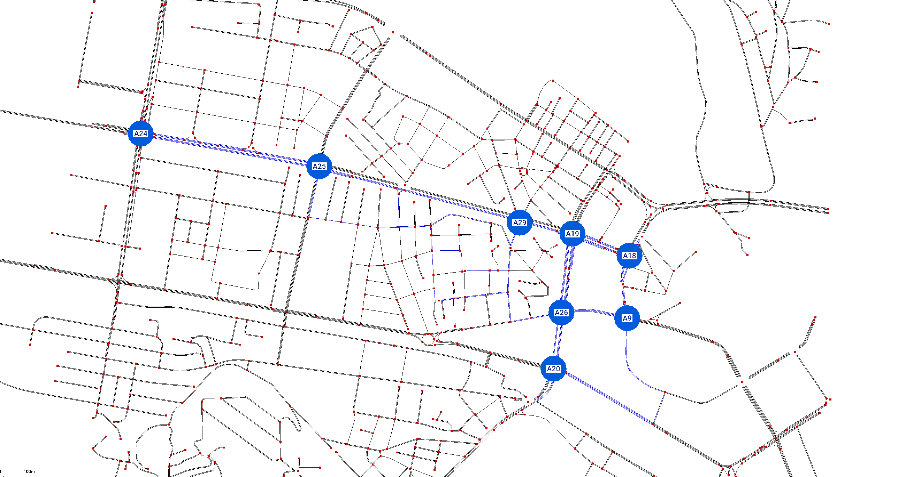
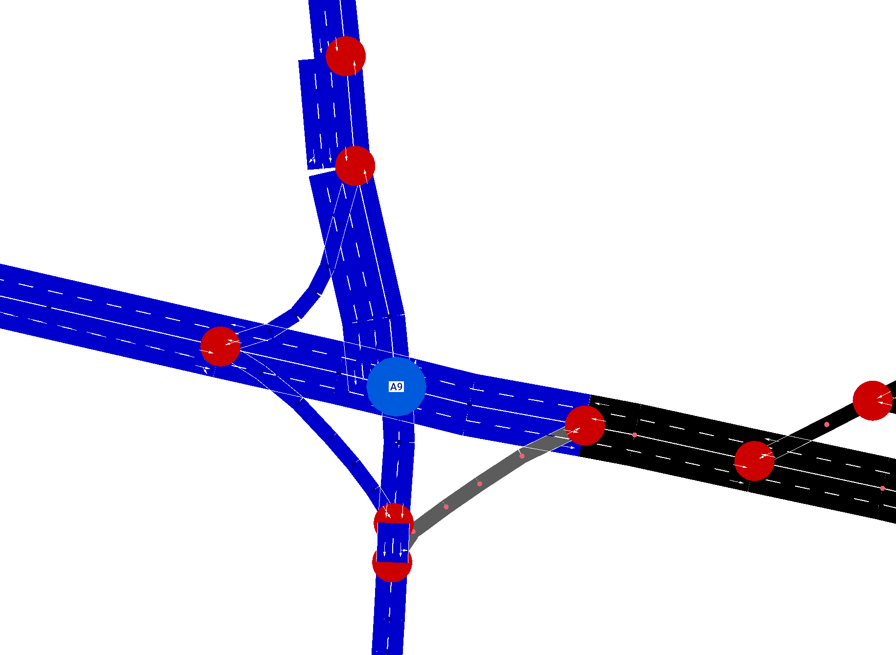
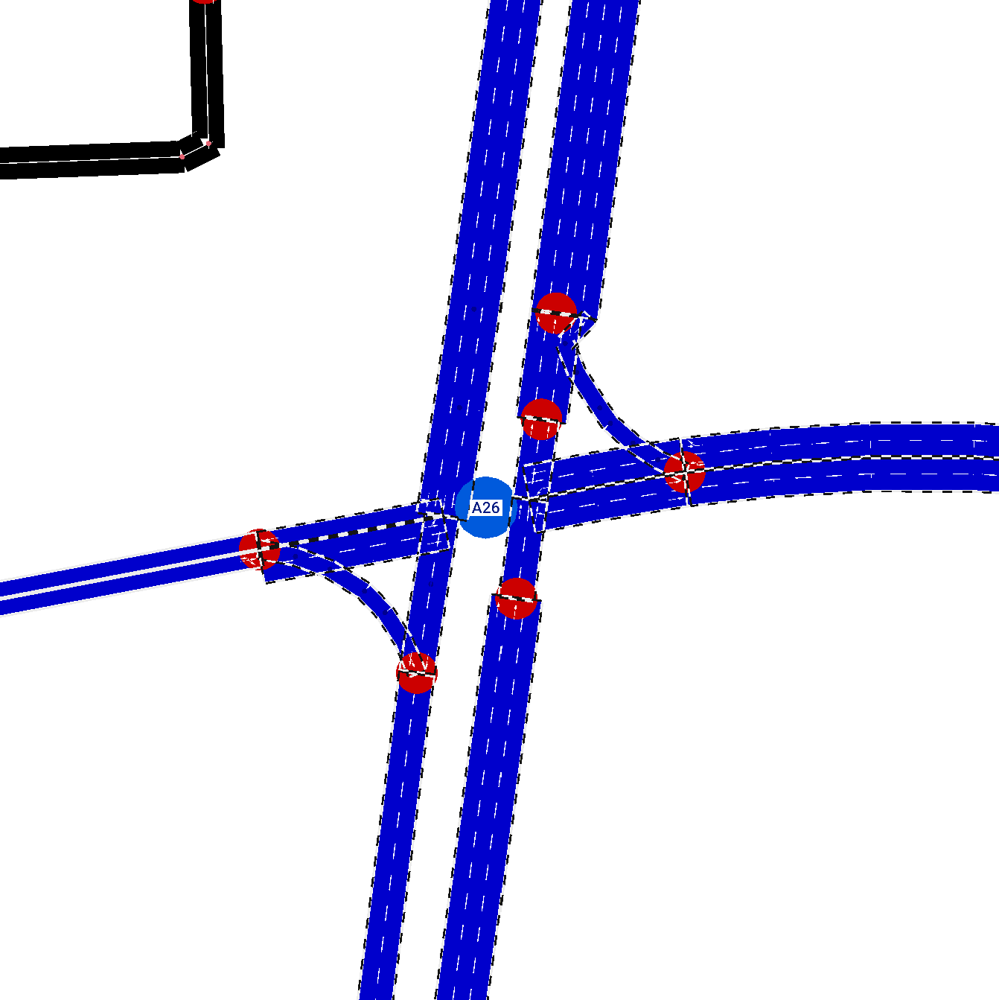

# Candidate 1 visual review

This sheet combines computed audit facts, the available Netedit screenshots, and a reproducible 600-second SUMO run.
Candidate 1 has a conditional review status and is not automatically selected by this document.

## Candidate definition

- Agents: A9, A18, A19, A20, A24, A25, A26, A29.
- Traffic-light IDs: `GS_12432953582`, `GS_cluster_170638629_170642149_170723177_418949594`, `GS_cluster_170640546_170645388_170684654_170684655`, `GS_cluster_170664726_3563678918`, `GS_cluster_1839000563_1839000611_1839000738_365292561`, `GS_cluster_2414241934_2593819789`, `GS_cluster_511207145_8301921419`, `cluster_12549999855_4127480432_4537363482_4537363483_#2more`.
- Description: Central connected candidate with audited links on several named multi-lane corridors.
- Selection file: `sumo/skopje/selections/candidate_1.txt`.

## Controller facts

| Agent | Traffic-light ID | Junction node IDs | Road names | Phases | Warnings |
| --- | --- | --- | --- | ---: | --- |
| A9 | `GS_12432953582` | 12432953582 | Васил Главинов; Даме Груев; Димитрие Чуповски | 4 | Controlled edge shorter than 5 m: -42874773#1, 42874773#0. |
| A18 | `GS_cluster_170638629_170642149_170723177_418949594` | cluster_170638629_170642149_170723177_418949594 | Булевар Блаже Конески; Булевар Партизански одреди; Васил Главинов | 4 | None |
| A19 | `GS_cluster_170640546_170645388_170684654_170684655` | cluster_170640546_170645388_170684654_170684655 | Булевар Партизански одреди; Булевар Свети Климент Охридски | 9 | Wizard reported actuated links without a controlling detector. |
| A20 | `GS_cluster_170664726_3563678918` | cluster_170664726_3563678918 | Булевар Водњанска; Булевар Свети Климент Охридски; Св. Кирил и Методиј | 8 | None |
| A24 | `GS_cluster_1839000563_1839000611_1839000738_365292561` | cluster_1839000563_1839000611_1839000738_365292561 | Булевар 8-ми Септември; Булевар Партизански одреди | 8 | None |
| A25 | `GS_cluster_2414241934_2593819789` | cluster_2414241934_2593819789 | Булевар Партизански одреди; Франклин Рузвелт | 4 | None |
| A26 | `GS_cluster_511207145_8301921419` | cluster_511207145_8301921419 | Булевар Свети Климент Охридски; Димитрие Чуповски; Митрополит Теодосиј Гологанов | 9 | Controlled edge shorter than 5 m: 1303162784, 1303162785. |
| A29 | `cluster_12549999855_4127480432_4537363482_4537363483_#2more` | cluster_12549999855_4127480432_4537363482_4537363483_#2more | Булевар Партизански одреди; Ленинова | 4 | None |

## Candidate neighbor adjacency

- A9 -> A18 (173.35 m), A19 (477.56 m), A20 (881.55 m), A26 (213.53 m).
- A18 -> A9 (185.18 m), A19 (167.75 m), A20 (1487.05 m), A26 (399.35 m).
- A19 -> A9 (376.35 m), A18 (194.82 m), A26 (275.62 m).
- A20 -> A26 (188.45 m).
- A24 -> A25 (662.48 m).
- A25 -> A20 (1392.49 m), A24 (616.20 m), A26 (1220.00 m), A29 (782.13 m).
- A26 -> A9 (211.14 m), A18 (441.30 m), A19 (261.27 m), A20 (178.28 m), A25 (1277.26 m), A29 (470.49 m).
- A29 -> A19 (172.46 m), A20 (643.08 m), A25 (995.37 m), A26 (452.41 m).

## Directed neighbor distances

| Source | Target | Network distance | Direct corridor | Bidirectional |
| --- | --- | ---: | --- | --- |
| A9 | A18 | 173.35 m | yes | yes |
| A9 | A19 | 477.56 m | no | yes |
| A9 | A20 | 881.55 m | no | no |
| A9 | A26 | 213.53 m | yes | yes |
| A18 | A9 | 185.18 m | yes | yes |
| A18 | A19 | 167.75 m | yes | yes |
| A18 | A20 | 1487.05 m | no | no |
| A18 | A26 | 399.35 m | no | yes |
| A19 | A9 | 376.35 m | no | yes |
| A19 | A18 | 194.82 m | yes | yes |
| A19 | A26 | 275.62 m | yes | yes |
| A20 | A26 | 188.45 m | yes | yes |
| A24 | A25 | 662.48 m | yes | yes |
| A25 | A20 | 1392.49 m | no | no |
| A25 | A24 | 616.20 m | yes | yes |
| A25 | A26 | 1220.00 m | no | yes |
| A25 | A29 | 782.13 m | yes | yes |
| A26 | A9 | 211.14 m | yes | yes |
| A26 | A18 | 441.30 m | no | yes |
| A26 | A19 | 261.27 m | yes | yes |
| A26 | A20 | 178.28 m | yes | yes |
| A26 | A25 | 1277.26 m | no | yes |
| A26 | A29 | 470.49 m | no | yes |
| A29 | A19 | 172.46 m | yes | no |
| A29 | A20 | 643.08 m | no | no |
| A29 | A25 | 995.37 m | no | yes |
| A29 | A26 | 452.41 m | no | yes |

## Launch commands

Generate the candidate agent-label POIs:

```powershell
python scripts/inspection/generate_agent_labels.py
```

Open the complete network with the candidate selection in Netedit:

```powershell
python scripts/inspection/open_candidate_in_netedit.py --candidate 1
```

After Netedit opens, press F9, open the POI visualization settings, enable Show ID, enable constant text size, and increase the text size if labels such as A9 and A18 are too small.

Observe the original demand and signal programs in SUMO-GUI:

```powershell
python scripts/inspection/run_candidate_review.py --candidate 1 --seconds 600 --gui
```

## Review evidence

### Reproduced SUMO run

Candidate 1 was run for 600 seconds with seed 42 and the original SUMO traffic-light programs.
The recorded result was reproduced headlessly on 2026-07-18 without changing the network or signal programs.

- Vehicles that completed their routes: 295.
- Vehicles still active at the end: 185.
- Candidate controllers were sampled every 60 seconds for 10 samples.
- No persistent candidate queue, collision warning, teleport warning, or simulation failure appeared in the captured output.
- SUMO reported that bus stop `12387262086` is too short for one bus on lane `1339140549_0`; this is a separate scenario-cleanup warning and is not evidence of a Candidate 1 controller failure.

| Agent | Mean sampled queue | Mean sampled waiting time | Maximum sampled queue |
| --- | ---: | ---: | ---: |
| A9 | 0.00 | 0.00 s | 0 |
| A18 | 0.30 | 0.50 s | 1 |
| A19 | 1.70 | 2.98 s | 6 |
| A20 | 0.30 | 1.08 s | 2 |
| A24 | 0.30 | 1.50 s | 2 |
| A25 | 0.10 | 0.40 s | 1 |
| A26 | 0.50 | 0.88 s | 3 |
| A29 | 0.00 | 0.00 s | 0 |

The sampled queues at A19 and A26 later decreased, so the available run does not show a permanent blockage.
The synthetic demand was light and uneven, so this result demonstrates basic stability rather than performance under congestion.

### Screenshot observations

- The overview shows all eight candidate labels at their audited intersections.
- The candidate forms one connected central urban network with a clear east-west chain and several north-south branches.
- A24 and A25 are farther west than the compact A9, A18, A19, A20, A26, and A29 cluster, so the candidate is not a simple linear corridor.
- The A9 close-up shows a complex skewed multi-arm intersection with short internal geometry, consistent with its short-edge warning.
- The A26 close-up shows dense turning geometry across divided approaches, consistent with its short-edge warning.
- No obviously disconnected candidate approach is visible in the supplied overview, A9 close-up, or A26 close-up.
- The POI markers make the agent IDs readable but obscure part of the central lane and connection geometry during close inspection.

### Evidence still missing

- No A19 close-up was supplied even though A19 has the detector warning, 9 phases, 24 controlled links, and the largest sampled queue.
- No phase-by-phase Netedit screenshots were supplied for A9, A19, or A26.
- Conflicting green movements and required all-red transitions therefore remain unverified visually.
- Close-up lane and turn checks were not supplied for A18, A20, A24, A25, or A29.
- Behavior under medium or heavy congestion has not been tested and should not be inferred from the current synthetic demand.

## Provisional decision

Status: conditional accept for comparison with Candidates 2 and 3.

Candidate 1 is connected, uses several named multi-lane corridors, has strong bidirectional neighbor connectivity, and completed the reproducible 600-second run without a persistent candidate queue.
It should not receive final acceptance until A19 is inspected closely and the A9, A19, and A26 programs are checked phase by phase for conflicting greens and transition quality.
No original network correction is recommended from the available screenshots alone.

## Manual scoring

These provisional scores use only the computed audit, the supplied screenshots, and the reproduced run.
A score does not mark an unsupported phase-level check as complete.

| Criterion | Score 1-5 | Notes |
| --- | --- | --- |
| Main-road relevance | 4 | Named multi-lane corridors are present, but the subset also includes smaller inner-city links. |
| Geographic continuity | 4 | One connected central network is visible, although it is branched rather than a single linear corridor. |
| Intersection spacing | 3 | Several agents are closely spaced, while some detected candidate paths exceed 1 km. |
| Traffic-light quality | 3 | Yellow states exist in the audited programs, but A19 has a detector warning and phase conflicts remain visually unverified. |
| Lane and turn correctness | 3 | A9 and A26 appear connected in the close-ups, but the labels obscure their centers and six controllers lack close-up checks. |
| Manageable complexity | 3 | Eight agents are manageable, but A19 and A26 each have 9 phases and the corridor has several branches. |
| Coordination potential | 5 | The subset has 27 directed neighbor relationships, 11 bidirectional pairs, and several short direct-corridor links. |
| Visual clarity for presentation | 4 | The labeled overview communicates the candidate well, but the large POIs obscure close-up geometry. |
| Deadlock-free simulation | 4 | The 600-second run showed temporary queues but no persistent candidate blockage; heavier demand remains untested. |
| Overall suitability | 4 | Strong provisional candidate, subject to A19 inspection and phase-by-phase sign-off. |

## Screenshots

### Candidate 1 overview



### A9 short-edge inspection



### A26 short-edge inspection


