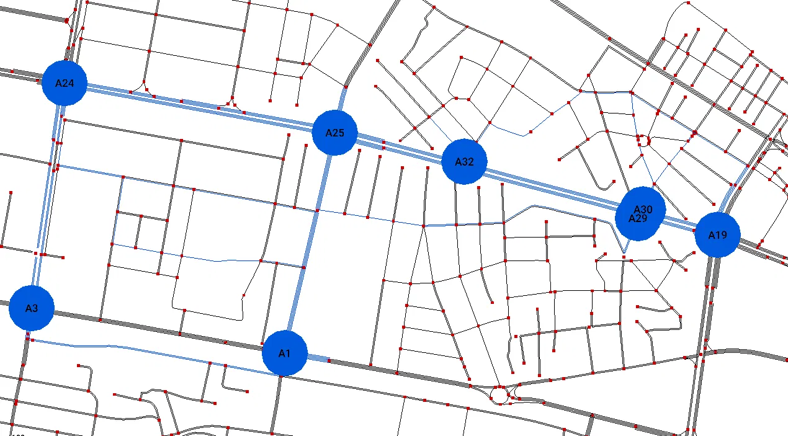
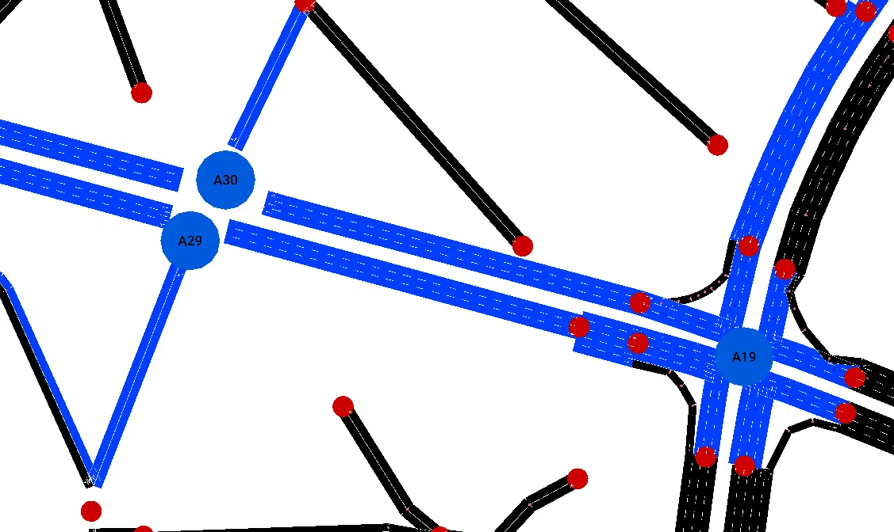

# Candidate 2 visual review

This sheet combines computed audit facts, the available Netedit screenshots, and a reproducible 600-second SUMO run.
Candidate 2 has a conditional review status and is not automatically selected by this document.

## Candidate definition

- Agents: A1, A3, A19, A24, A25, A29, A30, A32.
- Traffic-light IDs: `170654261`, `170654265`, `GS_cluster_170640546_170645388_170684654_170684655`, `GS_cluster_1839000563_1839000611_1839000738_365292561`, `GS_cluster_2414241934_2593819789`, `cluster_12549999855_4127480432_4537363482_4537363483_#2more`, `cluster_12549999856_2458486828_3830563710_6206171929_#3more`, `cluster_287496085_3830563709_6221854337_6221854340_#2more`.
- Description: Connected candidate centered on the audited east-west controller relationships.
- Selection file: `sumo/skopje/selections/candidate_2.txt`.

## Controller facts

| Agent | Traffic-light ID | Junction node IDs | Road names | Phases | Warnings |
| --- | --- | --- | --- | ---: | --- |
| A1 | `170654261` | 170654261 | Митрополит Теодосиј Гологанов; Франклин Рузвелт | 6 | None |
| A3 | `170654265` | 170654265 | Брадфордска; Булевар 8-ми Септември; Митрополит Теодосиј Гологанов | 8 | Wizard reported actuated links without a controlling detector.; Controlled edge shorter than 5 m: -379723256#1, 379723256#0. |
| A19 | `GS_cluster_170640546_170645388_170684654_170684655` | cluster_170640546_170645388_170684654_170684655 | Булевар Партизански одреди; Булевар Свети Климент Охридски | 9 | Wizard reported actuated links without a controlling detector. |
| A24 | `GS_cluster_1839000563_1839000611_1839000738_365292561` | cluster_1839000563_1839000611_1839000738_365292561 | Булевар 8-ми Септември; Булевар Партизански одреди | 8 | None |
| A25 | `GS_cluster_2414241934_2593819789` | cluster_2414241934_2593819789 | Булевар Партизански одреди; Франклин Рузвелт | 4 | None |
| A29 | `cluster_12549999855_4127480432_4537363482_4537363483_#2more` | cluster_12549999855_4127480432_4537363482_4537363483_#2more | Булевар Партизански одреди; Ленинова | 4 | None |
| A30 | `cluster_12549999856_2458486828_3830563710_6206171929_#3more` | cluster_12549999856_2458486828_3830563710_6206171929_#3more | Булевар Партизански одреди; Ленинова | 4 | None |
| A32 | `cluster_287496085_3830563709_6221854337_6221854340_#2more` | cluster_287496085_3830563709_6221854337_6221854340_#2more | Булевар Партизански одреди; Костурски Херои; Мајаковски | 6 | None |

## Candidate neighbor adjacency

- A1 -> A3 (716.59 m), A24 (1119.41 m), A25 (522.07 m), A29 (1302.17 m).
- A3 -> A1 (716.49 m), A24 (500.62 m), A25 (1111.07 m).
- A19 -> A30 (160.09 m).
- A24 -> A1 (1185.12 m), A3 (511.62 m), A25 (662.48 m).
- A25 -> A1 (522.46 m), A24 (616.20 m), A29 (782.13 m).
- A29 -> A1 (1167.65 m), A19 (172.46 m), A25 (995.37 m).
- A30 -> A19 (480.12 m), A32 (446.96 m).
- A32 -> A19 (916.20 m), A24 (1095.36 m), A25 (301.05 m), A30 (688.34 m).

## Directed neighbor distances

| Source | Target | Network distance | Direct corridor | Bidirectional |
| --- | --- | ---: | --- | --- |
| A1 | A3 | 716.59 m | no | yes |
| A1 | A24 | 1119.41 m | no | yes |
| A1 | A25 | 522.07 m | yes | yes |
| A1 | A29 | 1302.17 m | no | yes |
| A3 | A1 | 716.49 m | no | yes |
| A3 | A24 | 500.62 m | no | yes |
| A3 | A25 | 1111.07 m | no | no |
| A19 | A30 | 160.09 m | yes | yes |
| A24 | A1 | 1185.12 m | no | yes |
| A24 | A3 | 511.62 m | yes | yes |
| A24 | A25 | 662.48 m | yes | yes |
| A25 | A1 | 522.46 m | yes | yes |
| A25 | A24 | 616.20 m | yes | yes |
| A25 | A29 | 782.13 m | yes | yes |
| A29 | A1 | 1167.65 m | no | yes |
| A29 | A19 | 172.46 m | yes | no |
| A29 | A25 | 995.37 m | no | yes |
| A30 | A19 | 480.12 m | no | yes |
| A30 | A32 | 446.96 m | yes | yes |
| A32 | A19 | 916.20 m | no | no |
| A32 | A24 | 1095.36 m | no | no |
| A32 | A25 | 301.05 m | yes | no |
| A32 | A30 | 688.34 m | no | yes |

## Launch commands

Generate the candidate agent-label POIs:

```powershell
python scripts/inspection/generate_agent_labels.py
```

Open the complete network with the candidate selection in Netedit:

```powershell
python scripts/inspection/open_candidate_in_netedit.py --candidate 2
```

After Netedit opens, press F9, open the POI visualization settings, enable Show ID, enable constant text size, and increase the text size if labels such as A9 and A18 are too small.

Observe the original demand and signal programs in SUMO-GUI:

```powershell
python scripts/inspection/run_candidate_review.py --candidate 2 --seconds 600 --gui
```

## Review evidence

### Reproduced SUMO run

Candidate 2 was run for 600 seconds with seed 42 and the original SUMO traffic-light programs.

- Vehicles that completed their routes: 295.
- Vehicles still active at the end: 185.
- Candidate controllers were sampled every 60 seconds for 10 samples.
- No persistent candidate queue, collision warning, teleport warning, or simulation failure appeared in the captured output.
- SUMO reported that bus stop `12387262086` is too short for one bus on lane `1339140549_0`; this is a separate scenario-cleanup warning and is not evidence of a Candidate 2 controller failure.

| Agent | Mean sampled queue | Mean sampled waiting time | Maximum sampled queue |
| --- | ---: | ---: | ---: |
| A1 | 0.90 | 2.03 s | 2 |
| A3 | 0.10 | 0.65 s | 1 |
| A19 | 1.70 | 2.98 s | 6 |
| A24 | 0.30 | 1.50 s | 2 |
| A25 | 0.10 | 0.40 s | 1 |
| A29 | 0.00 | 0.00 s | 0 |
| A30 | 0.00 | 0.00 s | 0 |
| A32 | 0.20 | 0.36 s | 1 |

The sampled queues at A1, A19, and A24 rise and fall across the run rather than growing monotonically, so the available run does not show a permanent blockage.
The synthetic demand was light and uneven, so this result demonstrates basic stability rather than performance under congestion.

### Screenshot observations

- The overview shows all eight candidate labels; A29 and A30 sit close together in the cluster but both resolve to distinct junctions in the close-up.
- The A3 close-up shows a resolved four-leg intersection with dual-carriageway approaches on two legs and clean turn-lane geometry, despite its detector and short-edge warnings.
- The A19/A29/A30 close-up shows a connected corridor with A29 and A30 as separate, closely-spaced junctions rather than a single merged one; A19 is a larger multi-arm junction with dense connection points but nothing visibly disconnected.
- No obviously broken lane or turn geometry is visible in the supplied overview or close-ups.

### Evidence still missing

- No phase-by-phase Netedit screenshots were supplied for A3 or A19, so conflicting green movements and required all-red transitions remain unverified visually, despite both having detector warnings.
- Close-up lane and turn checks were not supplied for A1, A24, A25, or A32.
- Behavior under medium or heavy congestion has not been tested and should not be inferred from the current synthetic demand.

## Provisional decision

Status: conditional accept for comparison with Candidates 1 and 3.

Candidate 2 is connected, uses several named multi-lane corridors, has strong bidirectional neighbor connectivity around the A1/A3/A24/A25 loop and the A19/A29/A30 cluster, and completed the reproducible 600-second run without a persistent candidate queue.
It should not receive final acceptance until A3 and A19 are checked phase by phase for conflicting greens and transition quality, matching the same open item Candidate 1 has for A19.
No original network correction is recommended from the available screenshots alone.

## Manual scoring

These provisional scores use only the computed audit, the supplied screenshots, and the reproduced run.
A score does not mark an unsupported phase-level check as complete.

| Criterion | Score 1-5 | Notes |
| --- | --- | --- |
| Main-road relevance | 4 | Named multi-lane corridors dominate the subset; the Ленинова link near A29/A30 is a smaller connector. |
| Geographic continuity | 3 | The candidate is connected, but forms a loop (A24–A3–A1–A25) plus a spur out to A32–A30/A29–A19 rather than one linear corridor. |
| Intersection spacing | 3 | A29 and A30 sit very close together, while other legs of the candidate exceed 1 km, so spacing is uneven. |
| Traffic-light quality | 3 | Yellow states exist in the audited programs and the run showed no conflict symptoms, but A3 and A19 both carry detector warnings and phase conflicts remain visually unverified. |
| Lane and turn correctness | 4 | The A3 and A19/A29/A30 close-ups show clean, connected turn-lane geometry with nothing obviously broken; A1, A24, A25, and A32 lack close-up checks. |
| Manageable complexity | 3 | Eight agents is manageable, but A3 (8 phases) and A19 (9 phases) are both complex, closely-spaced junctions. |
| Coordination potential | 4 | The subset shows strong bidirectional connectivity around the A1/A3/A24/A25 loop and the A19/A29/A30 cluster, with several short direct-corridor links. |
| Visual clarity for presentation | 4 | The labeled overview communicates the candidate well; the A29/A30 labels sit close together but resolve clearly on close inspection. |
| Deadlock-free simulation | 4 | The 600-second run showed temporary, self-clearing queues and no persistent candidate blockage; heavier demand remains untested. |
| Overall suitability | 4 | Strong provisional candidate, subject to A3 and A19 phase-by-phase sign-off. |

## Screenshots

### Candidate 2 overview



### A3 detector/short-edge inspection


### A19/A29/A30 cluster inspection

