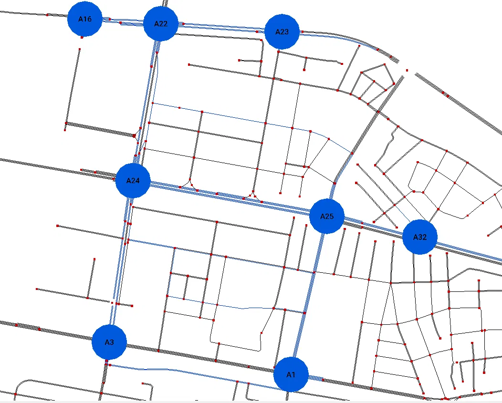
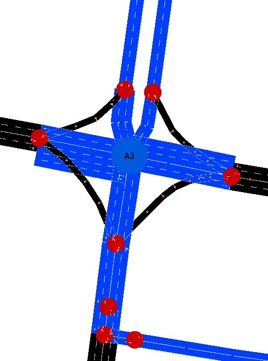
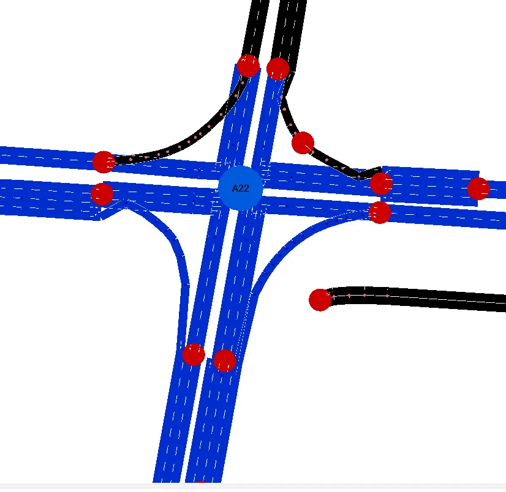

# Candidate 3 visual review

This sheet combines computed audit facts, the available Netedit screenshots, and a reproducible 600-second SUMO run.
Candidate 3 has a conditional review status and is not automatically selected by this document.

## Candidate definition

- Agents: A1, A3, A16, A22, A23, A24, A25, A32.
- Traffic-light IDs: `170654261`, `170654265`, `GS_cluster_12597592292_12900568847`, `GS_cluster_170743760_170745068_1839000773_1839000952`, `GS_cluster_170750136_1839001105`, `GS_cluster_1839000563_1839000611_1839000738_365292561`, `GS_cluster_2414241934_2593819789`, `cluster_287496085_3830563709_6221854337_6221854340_#2more`.
- Description: Connected candidate spanning audited northern and central controller relationships.
- Selection file: `sumo/skopje/selections/candidate_3.txt`.

## Controller facts

| Agent | Traffic-light ID | Junction node IDs | Road names | Phases | Warnings |
| --- | --- | --- | --- | ---: | --- |
| A1 | `170654261` | 170654261 | Митрополит Теодосиј Гологанов; Франклин Рузвелт | 6 | None |
| A3 | `170654265` | 170654265 | Брадфордска; Булевар 8-ми Септември; Митрополит Теодосиј Гологанов | 8 | Wizard reported actuated links without a controlling detector.; Controlled edge shorter than 5 m: -379723256#1, 379723256#0. |
| A16 | `GS_cluster_12597592292_12900568847` | cluster_12597592292_12900568847 | Бледски договор; Илинден | 6 | None |
| A22 | `GS_cluster_170743760_170745068_1839000773_1839000952` | cluster_170743760_170745068_1839000773_1839000952 | Булевар 8-ми Септември; Илинден | 8 | Controlled edge shorter than 5 m: 671704459#0. |
| A23 | `GS_cluster_170750136_1839001105` | cluster_170750136_1839001105 | Илинден; Никола Тесла | 6 | None |
| A24 | `GS_cluster_1839000563_1839000611_1839000738_365292561` | cluster_1839000563_1839000611_1839000738_365292561 | Булевар 8-ми Септември; Булевар Партизански одреди | 8 | None |
| A25 | `GS_cluster_2414241934_2593819789` | cluster_2414241934_2593819789 | Булевар Партизански одреди; Франклин Рузвелт | 4 | None |
| A32 | `cluster_287496085_3830563709_6221854337_6221854340_#2more` | cluster_287496085_3830563709_6221854337_6221854340_#2more | Булевар Партизански одреди; Костурски Херои; Мајаковски | 6 | None |

## Candidate neighbor adjacency

- A1 -> A3 (716.59 m), A24 (1119.41 m), A25 (522.07 m).
- A3 -> A1 (716.49 m), A24 (500.62 m), A25 (1111.07 m).
- A16 -> A22 (242.81 m), A24 (741.79 m).
- A22 -> A16 (225.11 m), A23 (397.94 m), A24 (504.31 m).
- A23 -> A22 (413.41 m).
- A24 -> A1 (1185.12 m), A3 (511.62 m), A22 (463.06 m), A23 (860.27 m), A25 (662.48 m).
- A25 -> A1 (522.46 m), A22 (1074.63 m), A23 (1471.84 m), A24 (616.20 m).
- A32 -> A22 (1427.99 m), A24 (1095.36 m), A25 (301.05 m).

## Directed neighbor distances

| Source | Target | Network distance | Direct corridor | Bidirectional |
| --- | --- | ---: | --- | --- |
| A1 | A3 | 716.59 m | no | yes |
| A1 | A24 | 1119.41 m | no | yes |
| A1 | A25 | 522.07 m | yes | yes |
| A3 | A1 | 716.49 m | no | yes |
| A3 | A24 | 500.62 m | no | yes |
| A3 | A25 | 1111.07 m | no | no |
| A16 | A22 | 242.81 m | yes | yes |
| A16 | A24 | 741.79 m | no | no |
| A22 | A16 | 225.11 m | yes | yes |
| A22 | A23 | 397.94 m | yes | yes |
| A22 | A24 | 504.31 m | yes | yes |
| A23 | A22 | 413.41 m | yes | yes |
| A24 | A1 | 1185.12 m | no | yes |
| A24 | A3 | 511.62 m | yes | yes |
| A24 | A22 | 463.06 m | yes | yes |
| A24 | A23 | 860.27 m | no | no |
| A24 | A25 | 662.48 m | yes | yes |
| A25 | A1 | 522.46 m | yes | yes |
| A25 | A22 | 1074.63 m | no | no |
| A25 | A23 | 1471.84 m | no | no |
| A25 | A24 | 616.20 m | yes | yes |
| A32 | A22 | 1427.99 m | no | no |
| A32 | A24 | 1095.36 m | no | no |
| A32 | A25 | 301.05 m | yes | no |

## Launch commands

Generate the candidate agent-label POIs:

```powershell
python scripts/generate_agent_labels.py
```

Open the complete network with the candidate selection in Netedit:

```powershell
python scripts/open_candidate_in_netedit.py --candidate 3
```

After Netedit opens, press F9, open the POI visualization settings, enable Show ID, enable constant text size, and increase the text size if labels such as A9 and A18 are too small.

Observe the original demand and signal programs in SUMO-GUI:

```powershell
python scripts/run_candidate_review.py --candidate 3 --seconds 600 --gui
```

## Review evidence

### Reproduced SUMO run

Candidate 3 was run for 600 seconds with seed 42 and the original SUMO traffic-light programs.

- Vehicles that completed their routes: 295.
- Vehicles still active at the end: 185.
- Candidate controllers were sampled every 60 seconds for 10 samples.
- No persistent candidate queue, collision warning, teleport warning, or simulation failure appeared in the captured output.
- SUMO reported that bus stop `12387262086` is too short for one bus on lane `1339140549_0`; this is a separate scenario-cleanup warning and is not evidence of a Candidate 3 controller failure.
- The city-wide demand, seed, and vehicle counts match the reproduced Candidate 1 and Candidate 2 runs, since all three candidates are sampled from the same underlying simulation rather than run in isolation. This makes the per-agent comparisons across candidates directly comparable.

| Agent | Mean sampled queue | Mean sampled waiting time | Maximum sampled queue |
| --- | ---: | ---: | ---: |
| A1 | 0.90 | 2.03 s | 2 |
| A3 | 0.10 | 0.65 s | 1 |
| A16 | 0.10 | 0.80 s | 1 |
| A22 | 0.10 | 0.20 s | 1 |
| A23 | 0.30 | 1.25 s | 2 |
| A24 | 0.30 | 1.50 s | 2 |
| A25 | 0.10 | 0.40 s | 1 |
| A32 | 0.20 | 0.36 s | 1 |

Sampled queues rise and fall across the run for every agent that ever shows a nonzero value, so the available run does not show a permanent blockage. Compared with Candidates 1 and 2, Candidate 3 has the lowest maximum sampled queue at any single controller (2, tied with A1/A23/A24) and no controller reaching the queue=6 spike seen at A19 in the other two candidates.

### Screenshot observations

- The overview shows all eight candidate labels forming a clear grid: A16–A22–A23 along the north edge, A24 connecting south to A3 and A1, and A25–A32 branching east — more visually linear than Candidates 1 and 2.
- The A3 close-up shows a resolved four-leg intersection with dual-carriageway approaches on two legs and clean turn-lane geometry, despite its detector and short-edge warnings.
- The A22 close-up shows a multi-arm junction with all approaches resolved into distinct connection points, including a ramp-like merging arm; nothing is visibly disconnected despite the short-edge warning.
- No obviously broken lane or turn geometry is visible in the supplied overview or close-ups.

### Evidence still missing

- No phase-by-phase Netedit screenshots were supplied for A3 or A22, so conflicting green movements and required all-red transitions remain unverified visually, despite both having short-edge warnings.
- Close-up lane and turn checks were not supplied for A1, A16, A23, A24, A25, or A32.
- Behavior under medium or heavy congestion has not been tested and should not be inferred from the current synthetic demand.

## Provisional decision

Status: conditional accept for comparison with Candidates 1 and 2.

Candidate 3 is connected, forms the most visually linear grid of the three candidates, uses several named multi-lane corridors, and completed the reproducible 600-second run with the lowest peak queue of any candidate reviewed so far.
It should not receive final acceptance until A3 and A22 are checked phase by phase for conflicting greens and transition quality.
No original network correction is recommended from the available screenshots alone.

## Manual scoring

These provisional scores use only the computed audit, the supplied screenshots, and the reproduced run.
A score does not mark an unsupported phase-level check as complete.

| Criterion | Score 1-5 | Notes |
| --- | --- | --- |
| Main-road relevance | 4 | Named multi-lane corridors dominate the subset (Илинден, Булевар 8-ми Септември, Партизански одреди). |
| Geographic continuity | 4 | The overview shows a clear connected grid (A16–A22–A23 north, A24 south to A3/A1, A25–A32 east) that reads more linearly than Candidates 1 and 2. |
| Intersection spacing | 4 | Most agents are spaced within a few hundred meters of each other; only A32's link to A22 and A25's link to A23 exceed 1 km. |
| Traffic-light quality | 3 | Yellow states exist in the audited programs and the run showed no conflict symptoms, but A3 and A22 both carry short-edge warnings and phase conflicts remain visually unverified. |
| Lane and turn correctness | 4 | The A3 and A22 close-ups show clean, fully-resolved connection geometry with nothing obviously broken; A1, A16, A23, A24, A25, and A32 lack close-up checks. |
| Manageable complexity | 3 | Eight agents is manageable, but A3 and A22 both have 8 phases, and A24 also has 8 phases, giving the candidate three complex controllers. |
| Coordination potential | 4 | Strong bidirectional connectivity through the A16/A22/A23/A24 cluster and the A1/A3/A24/A25 loop, with several short direct-corridor links. |
| Visual clarity for presentation | 5 | The labeled overview reads as the clearest single corridor of the three candidates, with an easy-to-narrate north-to-south and east branch structure. |
| Deadlock-free simulation | 4 | The 600-second run showed temporary, self-clearing queues, the lowest peak queue among the three candidates, and no persistent blockage; heavier demand remains untested. |
| Overall suitability | 4 | Strong provisional candidate with the cleanest visual layout so far, subject to A3 and A22 phase-by-phase sign-off. |

## Screenshots

### Candidate 3 overview



### A3 detector/short-edge inspection



### A22 short-edge inspection

